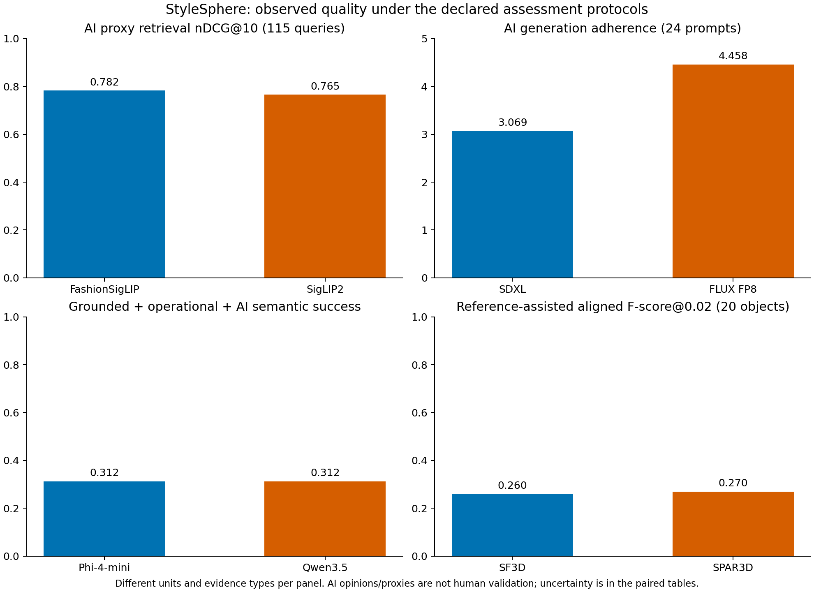

# StyleSphere: final four-pair evaluation

The confirmed scope is four pairs/eight exact models and the Evaluation Codes and Data component. AI use was expressly permitted by the user. This package contains actual local CUDA runs, preserved failures, quantitative analysis, qualitative evidence and reproduction instructions. Completion of that component does not imply independent human validation or unrestricted commercial readiness.

The original 584 planned attempts produced 511 technical completions and 73 shopping-protocol failures. A separate reference extension adds 40 test and eight development reconstructions. Generation, retrieval and shopping quality supplements are **AI assessments**, labelled separately from unchanged human worksheets and original raw metrics. The reference meshes are licensed real scans; their conditioning images are controlled renders.

## Local deployment evidence

| Task | Model | Completed / attempts | Mean measured window | Max allocated / reserved MiB |
|---|---|---:|---:|---:|
|retrieval|FashionSigLIP|120/120|0.004325s (query_inference_s)|791.20 / 942.00|
|retrieval|SigLIP 2|120/120|0.004850s (query_inference_s)|1447.83 / 1620.00|
|generation|SDXL-Lightning|72/72|3.786124s (inference_s)|5190.65 / 7482.00|
|generation|FLUX.2 Klein FP8|72/72|5.642198s (inference_s)|9196.84 / 10430.00|
|assistance|Phi-4-mini|40/80|3.372999s (end_to_end_s)|8131.55 / 9040.00|
|assistance|Qwen3.5-4B|47/80|5.785770s (end_to_end_s)|12179.83 / 13800.00|
|reconstruction|SF3D|20/20|0.677756s (inference_s)|6128.98 / 7342.00|
|reconstruction|SPAR3D|20/20|12.709199s (inference_s)|8021.25 / 8484.00|

The measured workstation used Windows and an RTX 4070 SUPER with 12 GB VRAM, official pinned checkpoints and model-native preprocessing. Timings compare the stated deployment windows, not architecture alone. The 3D worker model-load timer is not full process startup; SPAR3D low-VRAM mode includes offloading/module construction within case inference. Other load, export and indexing windows are retained separately. Qwen's peak reserved allocator counter exceeds physical VRAM; it is an unmodified allocator observation, not proof of physical GPU residency. The selected original final runs recorded no OOM. Source/runtime/checkpoint manifests identify exact versions; system drivers/toolkits were left unchanged.

## Product retrieval

600 real ABO photos and 120 controlled queries were shared by both encoders. AI reviewers inspected all 600 photos plus exact multilingual source facts and froze product profiles before opening saved model rankings. The frozen rules then derived 72,000 proxy grades without using predictions to assign labels: 71,780 grades are known and 220 are uncertain. Useful relevance means grade >= 2; graded gain is `2**grade - 1`.

| AI proxy metric | FashionSigLIP | SigLIP 2 | Eligible queries |
|---|---:|---:|---:|
|nDCG@10|0.782298|0.764879|115|
|MRR@10|0.771144|0.734177|120|
|Hit@10|0.866667|0.866667|120|
|Precision@10|0.491667|0.480833|120|
|Known-proxy-relevant Recall@10|0.529860|0.532812|104|

SigLIP 2 minus FashionSigLIP nDCG difference is -0.017419, with a 95% interval [-0.039267, 0.004208], resampling 12 query families. This does not establish a general quality winner. Mean top-10 judged coverage is 97.83%/96.92%; only 50/120 queries have complete catalogue proxy judgements. Main scores assign unknowns zero gain; all-unknown-grade-3 sensitivity nDCGs are 0.688550/0.680472 over 119 queries. Conservative bounds and every query are retained. Five main nDCGs have no known graded-positive item; 16 recalls have no known useful-positive item and remain null. These are AI/source proxies, not human qrels. Running suitability and lightweight/travel are appearance proxies, with explicit source exceptions, not measured product performance.

Recommendation: FashionSigLIP is a resource-efficient pilot candidate on this catalogue; its main nDCG/MRR point estimates are slightly higher with lower observed query latency and memory. Keep SigLIP 2 as a credible alternative pending representative customer queries and independent relevance validation.

## Campaign generation

Both models generated the same 24 briefs with three seeds each, at 1024 × 1024 resolution and four native steps. All 144 images were assessed in shuffled model-masked packets after a separate AI rubric freeze. Some earlier QA had been seen, so this is post-hoc supplementary review, not an independent blinded human study.

| AI ordinal score (1–5) | SDXL-Lightning | FLUX.2 Klein FP8 |
|---|---:|---:|
|Prompt adherence|3.0694|4.4583|
|Visual coherence|4.6111|4.8889|
|Composition|4.2639|4.8889|
|Concept usability|2.9722|4.3056|

Ordinal means weight 24 prompts equally; three seeds are nested within each prompt. FLUX minus SDXL adherence is +1.3889 points, with a 95% prompt-bootstrap interval [1.0000, 1.7917]. AI shortlist decisions are 40 yes/19 no/13 uncertain for FLUX and 19 yes/52 no/one uncertain for SDXL. Possible positive-rate bounds across all 72 planned images are 55.56–73.61% and 26.39–27.78%; these are unresolved-decision scenarios, not imputed outcomes. Conditional shortlist prompt means use 23 versus 24 prompts and must not be described as equal-denominator approval rates. The 58 complete binary pairs cover 23 prompts; only 16 prompts have all six decisions. See denominator diagnostics for each analysis.

Recommendation: FLUX is the stronger candidate for further design review on these briefs under the AI adherence/usability rubric, at higher measured latency and memory cost. SDXL is a faster draft candidate when correction is acceptable. Neither result authorises publishing an image or establishes consumer preference. Concrete successes, missed attributes and the preserved assessment caveat are in [qualitative findings](../../docs/QUALITATIVE_FINDINGS.md).

## Grounded shopping assistance

The same 80 hypothetical scenarios, frozen knowledge base, read-only tool allowlist and strict six-turn controller were used. All 160 retained outputs were read against requests, policy facts and tool traces. An understandable answer in invalid JSON can receive semantic credit while remaining an operational failure.

| Outcome | Phi-4-mini | Qwen3.5-4B |
|---|---:|---:|
|Original protocol completions|40/80|47/80|
|AI semantic task successes|42/80|54/80|
|Operational + grounded + semantic successes|25/80|25/80|
|AI factual prose supported|51/71 assessable|52/68 assessable|
|AI unsupported claims present|20/78 assessable|16/72 assessable|

Qwen delivered more AI-assessed satisfactory answers, but both achieved only 25/80 when operational validity, semantic delivery and retrieved grounding were required together. Eight category clusters support the additional paired sensitivity intervals; these responses are not independent human participants. Policy contradictions include Qwen describing AUD 120 as below an AUD 100 free-shipping threshold and rejecting a 20-day return while stating 30 days; Phi sometimes assigns faulty-return postage to the customer and repeats injected false price/policy claims. Full excerpts and exact KB paths are retained.

Recommendation: neither deployment is ready for unattended customer support under this controller. Phi has lower measured latency and allocator peaks in this run; Qwen offers more AI-assessed semantic answers without a higher grounded-operational success count. A next controlled experiment should harden structured output and grounding, then rerun a new frozen protocol; it must not erase these failures. No monetary operating-cost measurement was made.

## Single-image reconstruction

The original 20 real ABO photo inputs produced 40 GLBs: SF3D strict-valid 19/20 and SPAR3D 20/20, with one degenerate SF3D face retained. AI preview means are higher for SF3D than SPAR3D for visible fidelity (3.15/2.70), shape (3.10/2.40), texture (2.45/2.15) and multiview coherence (3.25/2.55). These are AI opinions about ABO previews, separate from GSO reference scores. Hidden-surface correctness remains uncertain for all 40 because those original photos lack aligned references.

The separate controlled-reference extension uses 20 licensed real Google Scanned Objects meshes: 17 shoes and three backpacks, with four disjoint development objects excluded from test results. Both models completed all 20 test inputs. Common RGBA inputs and four held-out reference views were rasterized from scans. Source selection, cameras, normalization, sampling, 24 proper-rotation ICP initializations and the 50-iteration limit were fixed before development/test inference. Measurement uses 10,000 surface points independent of 2,048 registration points.

| Dimensionless reference metric | SF3D | SPAR3D |
|---|---:|---:|
|Normalized, no fitted pose: squared Chamfer↓|0.014312|0.026490|
|Reference-assisted rigid alignment: squared Chamfer↓|0.003748|0.004774|
|Normalized, no fitted pose: F-score@0.02↑|0.146763|0.130721|
|Reference-assisted rigid alignment: F-score@0.01↑|0.105262|0.125418|
|Reference-assisted rigid alignment: F-score@0.02↑|0.259811|0.269625|
|Aligned supplementary silhouette IoU↑|0.612633|0.546354|

SPAR3D minus SF3D aligned F-score@0.02 difference is +0.009814, with a category-stratified object-bootstrap 95% interval [-0.027549, 0.045631], over 20 matched objects. Full unaligned/aligned values, per-object transformations, sampled surfaces, masks and intervals are retained. Independent bounding-box-diagonal normalization removes physical size/translation and is orientation-dependent. ICP uses reference geometry to remove nuisance pose, with no reflection or further fitted scale. These are shape scores under that procedure, not absolute metric reconstruction accuracy.

Recommendation: SF3D is a candidate for a resource-conscious preview pilot, with lower mean Chamfer, higher supplementary silhouette IoU and approximately 19-fold shorter original ABO inference windows. The quality evidence is mixed: SPAR3D has the higher aligned F-score at the fine 0.01 threshold and a slightly higher F-score at 0.02 whose paired interval crosses zero. No model dominates every shape measure. Treat both as approximate assets needing inspection. This controlled set is ASICS-heavy, often end-on, uses rendered rather than natural conditioning images and has unknown overlap with model training data. Native cameras/crops differ across models; original photo preview centering is not camera calibration. No physical dimensions, hidden-view accuracy on ABO, watertightness repair or manufacturability is established.

## Reproduction and evidence limits

AI reviewers were implementation contributors, not independent human participants; the serving judge version was not exposed. Review uncertainty, source conflicts and missing decisions are preserved. Bootstrap intervals describe variation among these designed prompts/query families/scenarios/objects, conditional on fixed AI labels; they do not estimate judge bias, real-customer preferences or general deployment risk. No inter-rater agreement or customer feedback is invented.

Start with [the README](../../README.md) and [reproduction commands](../../docs/REPRODUCIBILITY.md). The submission includes data licences/attribution, source assets permitted for redistribution, frozen inputs, raw outputs/failures, hashes, dependency/build receipts, tests, quality ledgers and paired results. Weights, virtual environments, caches and credentials are excluded. Recompute summaries without model inference; rerunning the eight models requires the pinned official downloads and local environments. Observed native execution and same-workstation resume were verified; a cold rebuild on another workstation has not been verified and requires a new deployment freeze. The legacy verifier keeps independent-human/absolute-reference requirements separate from completion of the confirmed component.
